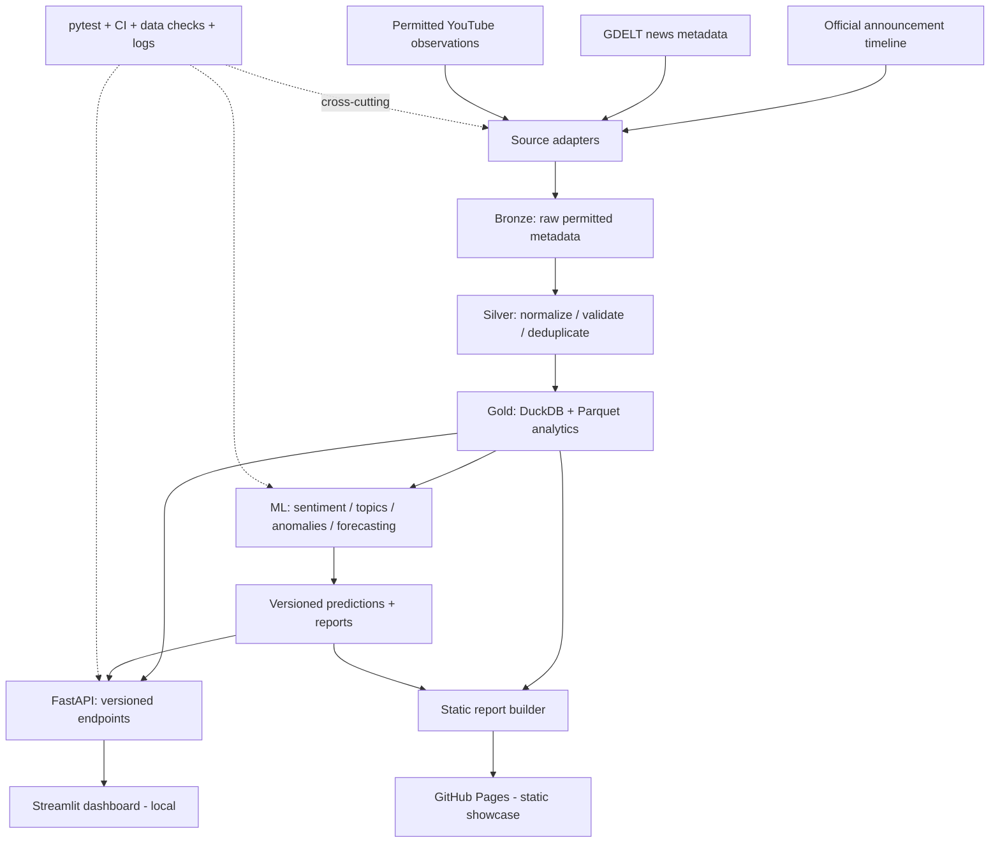

<div align="center">

# 🌴 VICE INTEL

### Open-source GTA VI Intelligence & Analytics Platform

**Track the conversation. Understand the sentiment. Explain the hype.**

*A reproducible, end-to-end data science and machine-learning project inspired by the public conversation around Grand Theft Auto VI.*

[](#project-status) [](#technology-stack) [](#license) [](#deployment-strategy)

**[Vision](#overview) · [Planned Features](#features) · [Architecture](#architecture) · [Quick Start](#quick-start) · [Data](#data-sources-and-governance) · [ML](#machine-learning-methodology) · [Roadmap](#roadmap) · [Contributing](#contributing)**

> **🚧 Planning-stage repository:** This README is an implementation blueprint, **not a claim that the application already works**. No dashboard, API, models, datasets, benchmarks, container images, hosted demo, or CI workflow have been implemented at the time this README was authored. Instructions marked **PLANNED** become executable only when their milestones ship. Progress will be tracked in [Project Status](#project-status).

</div>

---

## Overview

**VICE INTEL** is a proposed local-first intelligence platform that turns permitted public GTA VI-related media and community data into transparent analytics. It is built to demonstrate **data ingestion, data quality, feature engineering, NLP, unsupervised learning, time-series validation, REST API engineering, and MLOps** in one coherent project.

### Questions the system aims to answer

- How does sentiment vary across sources and around official announcements?
- Which themes appear most often, and how do they change over time?
- When does coverage spike above normal levels?
- Can a model forecast seven-day activity more accurately than a seasonal naïve baseline?
- How fresh, complete, reproducible, and trustworthy are the results?

**Scope:** This project studies *observed coverage and sampled online discussion*. It does **not** measure all GTA VI players, infer official sales, or claim that correlation between announcements and conversation implies causation.

### Who is it for?

- **Recruiters and engineers:** a readable, testable, production-minded ML/data engineering portfolio.
- **Data scientists:** reproducible baselines, evaluations, dataset documentation, and failure analysis.
- **Curious fans and researchers:** transparent, browsable insights rather than unsupported predictions.
- **Open-source contributors:** isolated modules, clear tests, and approachable development tasks.

## Project status

**Current stage: Phase 1 / documentation and repository foundation.** The checklist below records what has actually been delivered in this version.

| Deliverable | Status | Notes |
|---|---|---|
| Product scope, system design, research questions | ✅ Specified | In this README |
| README and phased roadmap | ✅ Documented | Initial foundation |
| Python package + development tooling | ⬜ Planned | Phase 1 |
| Offline synthetic demo dataset | ⬜ Planned | Phase 1; must be labeled synthetic |
| Dashboard with genuine screenshots | ⬜ Planned | Initial UI in Phase 1 |
| Documented ingestion connectors | ⬜ Planned | Phase 2 |
| Curated, permitted real dataset | ⬜ Planned | Phase 2 |
| Sentiment classifiers + evaluation | ⬜ Planned | Phase 3 |
| Topic discovery + anomaly detection | ⬜ Planned | Phase 4 |
| Forecasts + rolling backtests | ⬜ Planned | Phase 5 |
| FastAPI endpoints + integration tests | ⬜ Planned | Phase 6 |
| Docker Compose + static public showcase | ⬜ Planned | Phase 7 |
| CI, documentation site, stable release | ⬜ Planned | Phases 1–8 |

**Milestone rule:** We only check an item off when committed code, tests, and/or a working artifact support it. No invented accuracy, dataset sizes, stars, coverage percentages, or demo URLs.

## Features

### Core capabilities — planned

| Capability | Intended user experience | Engineering proof |
|---|---|---|
| **Intelligence Overview** | Explore daily coverage, engagement, source breakdown, and official-event markers | SQL analytics, dashboard design |
| **Sentiment Lab** | Filter and compare positive/negative/neutral reactions by source and date | NLP, supervised ML, calibration and error analysis |
| **Topic Explorer** | Inspect emerging themes, representative examples, and trends | Text embeddings, clustering, topic evaluation |
| **Hype & Forecasting Lab** | Observe unusual volume changes and seven-day predictions with intervals | Time-series features, rolling backtests, anomaly detection |
| **Data & Model Observatory** | See pipeline health, source coverage, model versions, and data freshness | Testing, reproducibility, observability |

### Advanced engineering — planned

- **Bronze → Silver → Gold** local data pipeline, with schema checks and deduplication.
- **Pluggable source connectors**, each with licensing/access documentation and failure handling.
- **Reproducible ML experiments**, model cards, and benchmark comparisons.
- **Versioned FastAPI** routes with typed schemas and auto-generated OpenAPI documentation.
- **Offline demo mode** requiring no API keys, no cloud accounts, and no real personal data.
- **Docker-based local deployment**, GitHub Actions CI, and a static public showcase.
- **Security, provenance, and source attribution** designed in from the start.

### Explicitly outside v1.0

A general-purpose AI chatbot, proprietary paid LLMs, GPU-intensive computer vision, Kubernetes, a custom React SPA, and an always-on public API. These can be reconsidered after a strong first release.

## Table of contents

- [Overview](#overview)
- [Project status](#project-status)
- [Features](#features)
- [Quick start](#quick-start)
- [Architecture](#architecture)
- [Technology stack](#technology-stack)
- [Data sources and governance](#data-sources-and-governance)
- [Machine learning methodology](#machine-learning-methodology)
- [Dashboard](#dashboard)
- [API design](#api-design)
- [Configuration](#configuration)
- [Docker setup](#docker-setup)
- [Deployment strategy](#deployment-strategy)
- [Observability](#observability)
- [Repository structure](#repository-structure)
- [Development and tests](#development-and-tests)
- [Reproducibility and evaluation](#reproducibility-and-evaluation)
- [Roadmap](#roadmap)
- [Contributing](#contributing)
- [Security and responsible use](#security-and-responsible-use)
- [License](#license)
- [Acknowledgments and disclaimer](#acknowledgments-and-disclaimer)

## Quick start

> **Not yet runnable.** The commands in this section define the intended developer experience after the relevant milestones are implemented. **Do not expect them to work in the README-only repository.** See the separate repository setup guide for steps you can perform today.

### Prerequisites — planned

- Python 3.12
- [`uv`](https://docs.astral.sh/uv/) for dependencies and isolated environments
- Git
- Optional: Docker Engine + Compose, or a compatible container runtime

### Local demo — planned

```bash
# Replace YOUR_USERNAME once the repository exists.
git clone https://github.com/YOUR_USERNAME/vice-intel.git
cd vice-intel

uv sync
uv run vice-intel demo-init             # Generates clearly marked synthetic samples
uv run streamlit run src/vice_intel/dashboard/app.py
```

**Expected future result:** A local Streamlit dashboard with an **explicit synthetic-data banner**. The complete application should also support permitted real-data workflows.

### CLI workflow — planned

```bash
uv run vice-intel ingest                # Collect permitted source data
uv run vice-intel validate              # Run quality checks
uv run vice-intel train                 # Train reproducible ML baselines
uv run vice-intel evaluate              # Export evaluation reports
uv run vice-intel build-report          # Build static analytics exports
uv run pytest                           # Run automated tests
```

### API access — planned

```bash
uv run uvicorn vice_intel.api.main:app --reload
# API docs: http://127.0.0.1:8000/docs
# Health:   http://127.0.0.1:8000/health
```

No production URL is published yet. When the public showcase ships, this section will contain a **real, verified link**.

## Architecture

**Design choice:** a **modular monolith**, not a distributed microservice system. Independent Python modules are easier to test, operate, and explain while still demonstrating clear service boundaries.



### Component responsibilities

| Component | Input | Output | Principle |
|---|---|---|---|
| Source adapters | Documented public APIs or permitted pages | Typed source records | Respect terms, rate limits, and provenance |
| Data pipeline | Source records | Validated Parquet / DuckDB tables | Idempotence, stable IDs, reproducibility |
| Feature layer | Cleaned records | Versioned features | No time leakage |
| Model layer | Features and labels | Metrics, models, predictions | Compare against simple baselines |
| API | Analytical tables and persisted predictions | Typed, versioned JSON | Fast, testable, documented |
| Dashboard | API responses or local read-only snapshots | Interactive visualizations | Source clarity and accessibility |
| Static exporter | Versioned analytics snapshots | Static charts and HTML | Free, no always-on server |

**Why this structure?** It exposes real data-to-decision engineering while avoiding the infrastructure overhead of unnecessary microservices.

## Technology stack

| Concern | Planned technology | Why |
|---|---|---|
| Python package | Python 3.12 + uv | Reproducible dependency management |
| Ingestion | httpx + Pydantic | Typed, testable adapters |
| Data transformation | pandas, DuckDB, Parquet | Accessible analytics and performant local storage |
| Data checks | Pandera + pytest | Schema and contract validation |
| Supervised ML | scikit-learn | Interpretable, competitive baselines |
| Semantic text | Sentence Transformers (optional advanced comparison) | Local embeddings without paid inference |
| API | FastAPI + Uvicorn | OpenAPI and validated responses |
| UI | Streamlit + Plotly | Fast, accessible analytics exploration |
| CLI | Typer | Discoverable command-line workflow |
| Quality | Ruff, pytest, pre-commit | Consistent contributions |
| Local deployment | Docker Compose | Reproducible local setup |
| Automation | GitHub Actions | CI and small permitted refresh jobs |
| Static docs/site | GitHub Pages; MkDocs later | No required hosting spend |
| Model tracking | Local MLflow (optional) | Transparent experiment metadata |

The actual versions will be pinned in `pyproject.toml` and `uv.lock` after implementation and compatibility testing.

## Data sources and governance

### Source plan

| Source | Planned fields | Role | Access and compliance |
|---|---|---|---|
| [Rockstar official site / Newswire](https://www.rockstargames.com/newswire) | Event dates, headline, source URL, event category | Verified official-event timeline | Curate and attribute; don't redistribute copyrighted assets |
| [GDELT](https://www.gdeltproject.org/) | Article URL, publisher, timestamp, query metadata | News coverage and coverage-volume analytics | Follow provider access conditions; avoid copying full article bodies |
| [YouTube Data API](https://developers.google.com/youtube/v3) | Public video metadata, counts, and permitted comment observations | Engagement and sample sentiment | Key/quota needed for collection; comply with platform terms and retention rules |
| [Google Trends](https://developers.google.com/search/apis/trends) | Search-interest indices, if approved | Possible future context | **Optional**; not a dependency of v1 |
| [Reddit Data API](https://redditinc.com/policies/data-api-terms) | Permitted community observations, if authorized | Potential future source | **Deferred**; approval and terms vary |

**Source coverage is not population coverage.** A model trained on YouTube comments must not be presented as measuring the views of all GTA VI players. Results should be segmented by source and time window.

### Data contracts — planned

| Table | Key columns | Description |
|---|---|---|
| `source_records` | `record_id`, `source`, `source_id`, `published_at`, `collected_at`, `url` | Source-level provenance |
| `text_samples` | `sample_id`, `record_id`, `text_hash`, `language`, `text` | Only authorized and appropriately retained text |
| `official_events` | `event_id`, `event_date`, `event_type`, `source_url` | Curated official-event evidence |
| `sentiment_predictions` | `sample_id`, `model_version`, `label`, `confidence` | Versioned NLP outputs |
| `topic_assignments` | `sample_id`, `topic_id`, `model_version` | Versioned topic assignments |
| `daily_metrics` | `date`, `source`, `record_count`, `coverage_status` | Time-series aggregates |
| `forecasts` | `target_date`, `created_at`, `prediction`, `lower`, `upper` | Backtestable forecasts |

**Timestamp contract:** distinguish `published_at` from `collected_at`, use UTC internally, preserve source timezone information where relevant, and evaluate only on observations available at prediction time.

### Data modes — planned

1. **Demo mode:** deterministic **synthetic** fixture data, requiring no external access.
2. **Reproducible sample mode:** a small, source-attributed real dataset **only if redistribution is permitted**.
3. **Live-collection mode:** optional local API-key-based collection, with throttling, retries, and clear error handling.

Prohibited in the repository without authorization: bulk scraped copyrighted article text, personal data, platform-prohibited comment archives, secrets, and large generated binary artifacts. Source permissions and deletion/retention requirements will be documented per connector.

## Machine learning methodology

The project prioritizes **evaluation discipline over flashy accuracy claims**.

### 1. Sentiment classification

**Question:** Can we classify the tone of sampled GTA VI-related text as positive, neutral, or negative?

- **Baseline:** TF-IDF + Logistic Regression.
- **Traditional comparator:** TF-IDF + Linear SVM.
- **Advanced comparator:** a lightweight local pretrained transformer, subject to resources and license.
- **Labels:** manually defined annotation guidelines, an adjudicated evaluation sample, and explicit ambiguous/sarcastic examples.
- **Metrics:** macro F1, precision/recall per class, confusion matrix, calibration diagnostics, and failure examples.
- **Split policy:** group related/duplicate examples and use time-aware validation when evaluating generalization to future discussions.

**Important:** general-purpose pretrained sentiment models are not automatically valid for gamer slang, sarcasm, or the specific topic.

### 2. Topic discovery

- Start with TF-IDF and a simple clustering baseline.
- Compare sentence embeddings + clustering and potentially BERTopic.
- Assess topic coherence, stability, outliers, and human interpretability.
- Display representative permitted examples, not just autogenerated topic names.

### 3. Seven-day activity forecasting

**Target:** daily source-specific coverage/engagement counts—not game sales.

- **Baseline:** seasonal naïve prediction.
- **Comparator:** exponential smoothing or a similar statistical method.
- **Advanced model:** gradient boosting on lag and rolling-window features.
- **Evaluation:** rolling-origin backtests, MAE, suitable scale-normalized errors, and interval coverage.
- **Leakage protection:** do not use future events, future article counts, or features unavailable at the forecast origin.

If the available historical window is too short, the forecasting study will be scoped down or labeled exploratory rather than reporting misleading results.

### 4. Activity anomaly detection

- Use rolling median/MAD or robust z-score baselines to flag unusual activity.
- Compare alerts against a reviewed official-event set.
- Report precision/recall and false positives, and avoid causal claims based on coincident timing.

### Model comparison requirements

Every published model report should include: dataset version, label provenance, train/validation/test strategy, baseline, parameter settings, random seeds, metrics, error analysis, training environment, limitations, and a reproducible command. **No benchmark numbers will appear until measured.**

## Dashboard

**Planned pages:**

1. **Intelligence Overview** — coverage volume, freshness, source distribution, official event timeline.
2. **Sentiment Lab** — per-source sentiment, confidence, filterable time windows, annotated examples.
3. **Topic Explorer** — topic labels, representative excerpts where permitted, trends over time.
4. **Hype & Forecasting Lab** — anomalies, predictions, confidence/uncertainty intervals, backtest charts.
5. **Data & Model Observatory** — pipeline status, validation outcomes, model versions, evaluation links.

**Design principles:** dark Vice City-inspired palette, accessible contrast and readable labels, mobile-aware layout, explicit data timestamps, source disclaimers, and clear separation of synthetic vs real data.

> Screenshots and demos will be added **after they exist**. No mocked visuals will be presented as real analytics results.

## API design

**Planned prefix:** `/api/v1` · **Documentation:** `/docs` · **Response models:** Pydantic.

| Method | Endpoint | Meaning |
|---|---|---|
| GET | `/health` | Application health |
| GET | `/api/v1/metrics/overview` | Headline metrics and freshness |
| GET | `/api/v1/sentiment` | Sentiment aggregates and filters |
| GET | `/api/v1/topics` | Topic distributions |
| GET | `/api/v1/trends` | Time-series observations |
| GET | `/api/v1/forecasts` | Versioned forecast results |
| GET | `/api/v1/models` | Model details and evaluation references |

Potential query parameters include `source`, `from`, `to`, `limit`, and `offset`; finalized schemas will be documented and tested before these routes are marked implemented.

**Planned response conventions:** ISO 8601 UTC timestamps, nullable metrics when coverage is insufficient, explicit model/data version fields, documented error bodies, input validation, and non-destructive read-only endpoints in v1.

## Configuration

> **PLANNED** — example schema, not yet recognized by an executable application.

```yaml
# configs/base.yaml — proposed format
app:
  mode: demo                     # demo | local
  timezone: UTC
storage:
  database_path: data/local/vice_intel.duckdb
  parquet_dir: data/local/parquet
pipeline:
  sources: [rockstar_events, gdelt, youtube]
  request_timeout_seconds: 20
  max_retries: 3
ml:
  random_seed: 42
  forecast_horizon_days: 7
  sentiment_model: tfidf_logreg
observability:
  log_level: INFO
```

**Proposed environment variables:** `YOUTUBE_API_KEY`, `VICE_INTEL_DATA_DIR`, `VICE_INTEL_LOG_LEVEL`. Real credentials belong in untracked local `.env` files, never the repo. A future `.env.example` will contain names only, not real secrets.

## Docker setup

> **PLANNED** — Dockerfile and `compose.yaml` are not shipped yet.

```bash
docker compose build
docker compose up
# Planned local services:
# dashboard http://localhost:8501
# API       http://localhost:8000/docs
```

Images should use non-root users where practical, fixed/pinned dependencies, health checks, and local volume mounts for persistent data. Docker is optional; direct Python commands remain supported.

## Deployment strategy

**Goal: $0 required recurring spend.**

| Environment | Planned hosting | Tradeoff |
|---|---|---|
| Full platform | Developer's machine | Full local API + dashboard; requires the user's computer |
| CI | GitHub Actions on eligible public repositories | Subject to GitHub runner and usage rules |
| Public showcase | GitHub Pages | Static, timestamped analytics; **not** an always-on backend |
| Documentation | GitHub Pages / repository Markdown | No paid hosting required |

The static showcase will be generated from versioned analytical snapshots. It must show **last successful refresh** and distinguish stale data, incomplete sources, and synthetic sample outputs. A hosted interactive Streamlit instance is not promised in v1.

## Observability

**Planned instrumentation** includes structured application logs, per-connector success/error counts, ingestion duration, rejected-row counts, source freshness timestamps, API request duration, and model inference/evaluation metadata.

A basic Observatory dashboard will expose the most useful health signals. Prometheus/Grafana may be added later if the local-first monitoring story warrants their operational overhead.

## Repository structure

**Target layout (many paths do not exist yet):**

```text
vice-intel/
├── .github/
│   ├── workflows/                # ci.yml, data-refresh.yml, docs.yml
│   ├── ISSUE_TEMPLATE/
│   └── PULL_REQUEST_TEMPLATE.md
├── configs/                      # base.yaml, sources.yaml
├── data/
│   ├── demo/                     # labeled synthetic fixtures
│   └── README.md                 # data handling rules
├── docs/
│   ├── architecture/
│   ├── data/
│   ├── ml/
│   └── guides/
├── notebooks/                    # exploratory notebooks, not production logic
├── src/vice_intel/
│   ├── ingestion/
│   ├── pipelines/
│   ├── features/
│   ├── models/
│   ├── analytics/
│   ├── api/
│   ├── dashboard/
│   └── observability/
├── tests/
│   ├── unit/
│   ├── integration/
│   └── contracts/
├── scripts/
├── reports/
│   ├── figures/
│   └── evaluations/
├── .env.example
├── .gitignore
├── .pre-commit-config.yaml
├── CONTRIBUTING.md
├── CODE_OF_CONDUCT.md
├── SECURITY.md
├── LICENSE
├── Makefile
├── Dockerfile
├── compose.yaml
├── pyproject.toml
├── uv.lock
└── README.md
```

**Separation rule:** production code belongs in `src/vice_intel/`; notebooks import reusable modules rather than hiding essential logic in notebook cells.

## Development and tests

> **PLANNED** — commands below require the package and tooling to be initialized.

```bash
uv sync --group dev
uv run ruff check .
uv run ruff format --check .
uv run pytest
uv run vice-intel validate
```

### Planned automated checks

- Unit tests for transformations, features, and inference wrappers.
- Integration tests against local fixture datasets and API schemas.
- Data contract tests: types, nullability, IDs, duplicate handling, time zones.
- Leakage tests for forecasting features and chronological splits.
- Reproducibility tests on deterministic small examples.
- CI jobs that run linting, tests, and package installation on pull requests.
- Smoke checks for Docker and documentation when those components ship.

We will set coverage and latency targets **after measuring a working baseline**; we will not add fabricated percentages or speed claims.

## Reproducibility and evaluation

Every released analytical result will link to or record:

- Data-source inventory and permissions, collection date, observation window, schema and dataset version.
- Transformation code version, duplicate policy, label guide, and missingness summary.
- Model version, seed, environment lockfile, train/test methodology, and baseline comparison.
- Evaluation metrics, error analysis, and limitations.
- A specific local command to regenerate the output when redistribution rights permit.

A machine-learning result that cannot be explained or reproduced will not be labeled production-ready.

## Roadmap

| Phase | Objective | Definition of done |
|---|---|---|
| **1 — Foundation** | README, project scaffolding, offline sample, basic UI, CI | New user can clone, install, test, and launch synthetic demo |
| **2 — Data engineering** | Adapters, Bronze/Silver/Gold, validation | Idempotent runs produce documented tables |
| **3 — Sentiment** | Baselines, annotation, evaluation | Reported metrics and failures on held-out labels |
| **4 — Topics & anomalies** | Interpretable themes, alert rules | Reviewable topic examples and validated alerts |
| **5 — Forecasts** | Baselines, advanced model, backtests | Versioned rolling evaluation with honest uncertainty |
| **6 — API** | Versioned endpoints, schemas, tests | Dashboard and API agree on results |
| **7 — Packaging & docs** | Docker, public static showcase, model/data cards | Clean-install guide and accessible demo |
| **8 — Launch** | Release, contributor onboarding, insights | Tagged, documented, community-ready v1.0 |

### Potential later work

Authorized community integrations, stronger domain adaptation, explicit model drift checks, cross-source comparison studies, more advanced topic evolution, and an optional custom frontend.

## Contributing

Contributions are welcome **once the repository and contribution infrastructure are available**. Early issues will be scoped so newcomers can contribute tests, documentation, connectors, visualizations, or evaluation improvements without needing paid APIs.

**Planned contribution workflow:**

1. Search issues and discussions before proposing work.
2. Comment on an issue or propose a well-scoped change.
3. Fork the repository and create a focused feature branch.
4. Make changes with corresponding tests and documentation.
5. Run the documented quality checks locally.
6. Open a pull request explaining the motivation, changes, validation, and any data/license implications.

A full `CONTRIBUTING.md`, issue templates, PR template, and `CODE_OF_CONDUCT.md` will be added during foundation work. We welcome constructive reviews and legitimate collaboration, not artificial stars, spam issues, or meaningless pull requests.

## Security and responsible use

- Never commit API keys, `.env` secrets, user tokens, or private logs.
- Use the least-privilege access needed for external APIs.
- Enforce request timeouts, retries with bounded backoff, and provider rate limits.
- Preserve attribution and honor content retention, deletion, and redistribution obligations.
- Avoid collecting unnecessary personal information or treating sampled comments as representative of all players.
- Report vulnerabilities privately through the repository's security reporting channel once configured; do not post exploit details in a public issue.
- Do not claim official association with Rockstar Games or Take-Two Interactive.

## License

**Planned license for original project code: [MIT License](https://opensource.org/license/mit).** The actual `LICENSE` file will be added before the repository is declared licensed. **Until then, do not assume source code has an MIT grant solely because this README says it is planned.**

The MIT license will apply only to original code expressly covered by the project license. Third-party assets, model weights, fetched content, trademarked names, provider data, and linked external materials keep their own rights and restrictions. Dataset licenses will be documented separately.

## Acknowledgments and disclaimer

Planned tools and platforms include Python, DuckDB, scikit-learn, Hugging Face's open-source ecosystem, FastAPI, Streamlit, Plotly, Docker, and GitHub. Attribution for specific assets and datasets will be added as each is introduced.

**Unofficial fan-made research/portfolio project.** VICE INTEL is not affiliated with, sponsored by, or endorsed by Rockstar Games or Take-Two Interactive. *Grand Theft Auto* and related marks belong to their respective owners. The project uses original branding and aims not to reproduce copyrighted game art or redistribute unauthorized platform content.

---

<div align="center">

**Built to make the data science understandable — and the engineering verifiable.**

*Follow the roadmap, open a meaningful issue, and help improve the evidence.*

</div>
